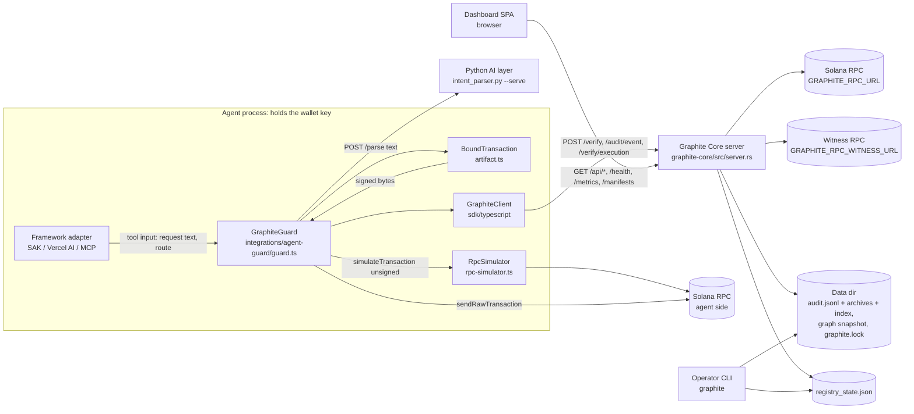
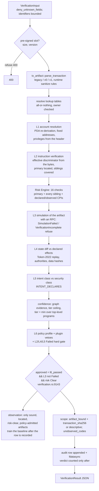

# Graphite architecture, reconstructed from the code (Round 30, at `29e4356`)

This page is built from the code: imports, routes, function calls, persisted files and every place
a key signs or bytes leave a process. The documents were used only to find where to look. Line
numbers are at `29e4356`. Trust boundaries are marked **TB-n**; every alternate path found is
listed in [Alternate paths](#alternate-paths-and-what-holds-each).

## 1. Components and who may call what



| Boundary | Between | What crosses | Defended by |
|---|---|---|---|
| TB-1 | Model / tool caller → adapter | request text, swap route instruction | zod schemas (`graphite-mcp.ts:173,194-203`, `graphite-tools.ts:101-131`); grounding in the guard |
| TB-2 | Guard → AI layer | the user's text out, a parse back | transport rule (`assertSecureAiLayerUrl`), 5 s timeout, 64 KiB bound, echo check, only four string fields read (`guard.ts:591-638`) |
| TB-3 | Guard → agent-side RPC | unsigned simulation, blockhash, ALT reads, `sendRawTransaction`, status polls | transport rule (`assertSecureRpcUrl`), no redirects, bounded reads (`readJsonBounded`), unsigned simulation (`rpc-simulator.ts`) |
| TB-4 | Guard → Core | `VerificationInput` with the unsigned artifact; lifecycle reports | transport rule, Bearer key, `redirect: "error"`, response shape validation (`client.ts:279,644-674`); **no response byte bound (K-03)** |
| TB-5 | Any HTTP client → Core | every route | `dev_mode_host_middleware` → `rate_limit_middleware` → `auth_middleware` → `concurrency_limit_middleware` (`server.rs:1659-1674`, the last added runs first), 1 MiB body, 10 s timeout, header timeout, connection caps |
| TB-6 | Core → its RPC and witness | simulations, account reads, statuses, chain bytes | endpoint validation at startup, `Policy::none()` redirects, value-count and byte bounds, budget (`RpcBudget`), strict field parsing (`rpc_client.rs`) |
| TB-7 | Core ↔ data directory | audit rows, archives, indexes, graph snapshot, lock | exclusive `graphite.lock`, fdatasync per row, snapshot generations, archive index SHA-256 check; **unkeyed: corruption-evident, not tamper-evident (G-07)** |
| TB-8 | Registry submitter → registry | signed manifest submissions | ed25519 over a domain-tagged canonical message, lineage, replay of the registry-owned corpus, revocation (`manifest_registry.rs`) |
| TB-9 | Browser → Core | dashboard reads with the API key | CSP in `index.html`, key per tab by default (`connection.ts`); the dashboard holds the **verify** key, which can also write (K-11) |
| TB-10 | CI → repository | workflow runs | `permissions: contents: read`, actions pinned by SHA, `persist-credentials: false`; **branch protection absent (G-11)** |

## 2. The verification pipeline (Core)

Entry: `POST /verify` → `verify_handler` (`server.rs:2209`) → `GraphiteCore::verify_async`
(`verification.rs:5483`, about 4,250 lines). The CLI's `graphite verify` calls the same function
through `operator_boundary` (shared settings since Round 29).



What decides `approved` (`verification.rs:8949-9143`):

- `structural_layer_failed` = L2 or L4 or L5 **Failed** (not Inconclusive).
- `l6_passed` = policy `Approved` and no L6 plugin Block and not `structural_layer_failed`.
- `simulation_layer_failed` = L3 Failed (flagged, errored, or a simulation plugin Block).
- `approved = l6_passed && !simulation_layer_failed && risk_summary.status == "Clear"`.
- An L1 identity failure is folded into the risk summary as `MaliciousAccountChange` /
  `AccountIdentityMismatch` (`verification.rs:6764-6823, 8661-8700`), so it refuses through
  `risk_summary`, not through L1's own status.
- `approved` does **not** consult `scope`: an approval without an RPC carries `not_simulated`
  and an approval of a description is `descriptive`. Only a consumer's residual policy refuses
  those (lead G-01; WS-A's `decision`/`executable` contract).

## 3. Signing and submission (agent side)

Every live sign and send sink in the repository, found by searching for `signTransaction`,
`sendRawTransaction`, `sendTransaction`, `.sign(`, `partialSign`, `signMessage`,
`sendAndConfirm*` across all TypeScript (tests excluded) and confirmed by reading:

| Sink | Where | Reached from | Preconditions on the path |
|---|---|---|---|
| `signTransaction(keyPairs, this.#tx)` (kit) | `artifact.ts:452`, inside `BoundTransaction.signAndFreeze` | only `signApproved` (`artifact.ts:388`), which only `executeBoundTransaction` calls (`execution-lifecycle.ts:210`) | `verification.approved`; `ResidualPolicy.assertExecutable` (artifact-bound, codes present and paired, every non-inherent code accepted); optional confirm hook; digest re-serialized and equal to `scope.transaction_sha256`; signer set equal to the message's required signers; one signing per object |
| `connection.sendRawTransaction(raw)` | `execution-lifecycle.ts:271` (`guard.ts:773` supplies the connection) | after the signing event is recorded and resolved by the exact `audit_trail_id` with `verdict_on_record == "approved"` (`execution-lifecycle.ts:218-253`) | the id is read from the signed bytes, never from the RPC's answer |
| `VerificationGatedWallet.sign*/send*` | `integrations/solana-agent-kit/gated-wallet.ts:68-88` | SAK plugins and LLM tools | every method throws `UngatedSigningRefused`; SAK is given the public key only (`graphite-sak-bridge.ts:85-86`) |
| `executeBoundTransaction` called directly | `integrations/agent-guard/devnet-test.ts:254` | a devnet demo script | residual policy and the trail checks apply; **the spend cap, grounding, AuditBind and the confirm hook do not** (K-09); devnet enforced by genesis hash |

```mermaid
sequenceDiagram
  participant M as Model / tool
  participant G as GraphiteGuard
  participant A as AI layer
  participant R as Agent RPC
  participant C as Core
  M->>G: executeTransfer(text) / executeSwap(text, route)
  G->>A: POST /parse (advisory)
  G->>G: ground text (grammar, negation, tokens), spend policy, unresolved-send check (K-02)
  G->>R: getLatestBlockhash (+ ALT reads / v1 limit simulation)
  G->>G: BoundTransaction.build (one compiled tx)
  G->>R: simulate unsigned bytes (swap: wallet effect, economics)
  G->>C: POST /verify (artifact)
  C-->>G: VerificationResult (shape-validated)
  G->>G: AuditBind on the bound instructions
  G->>G: ResidualPolicy; confirm(summary) [MCP passes it; Vercel does not (K-01)]
  G->>G: signApproved(digest) → signed bytes
  G->>C: POST /audit/event signing (exact id; must be approved on record)
  G->>R: sendRawTransaction
  G->>C: POST /audit/event submission (retried)
  G->>R: poll statuses until confirmed or blockhash expiry
  G->>C: POST /verify/execution (L8)
```

## 4. After submission: L8 and the trail

`POST /verify/execution` → `execution_handler` (`server.rs:2937`) →
`GraphiteCore::audit_execution` (`verification.rs:3514`):

1. Status from the primary RPC (and the witness, concurrently, under one `RpcBudget`).
2. `getTransaction` from each source that reported the signature, primary first; bytes are
   accepted only when bound to the signature (`tx_artifact::bound_artifact_sha256`: first slot
   equals the signature, ed25519 over the message under the fee payer). Rejected bytes are
   recorded and the next source is asked.
3. The record is joined by the chain digest (`find_verification(TransactionSha256)`), else by
   the caller's keys most-exact-first, cross-checked (`caller_keys_disagree`).
4. The reconciliation (`ExecutionReconciliation`) is appended as an `execution_check` row, or a
   `confirmation` only when inclusion was seen at a cluster-backed commitment (Round 29, M4).
   Only `BlockedButExecuted` is a discrepancy.

Without a witness the primary RPC alone decides inclusion (G-08). The trail is unkeyed JSON lines
with an unkeyed per-archive index (G-07).

## 5. Persistence

| File | Written by | Read by | Integrity |
|---|---|---|---|
| `<data>/audit.jsonl` | `AuditLog::append_line` (server, blocking pool), fdatasync per row | L8 join, lifecycle checks, dashboard scans, CLI | a failed append is undone or appends stop (Round 29); unkeyed |
| `<data>/audit.jsonl.<millis>-<seq>` archives | rotation at `GRAPHITE_AUDIT_ROTATE_BYTES` | same | exact archive names only; order by sequence, not wall clock |
| `<data>/audit.jsonl-index/<archive>.idx` | rotation; rebuilt on mismatch | indexed lookups | archive length + SHA-256 checked once per process; unkeyed |
| graph snapshot | `GraphiteCore` persistence | startup | generation counter; a corrupt snapshot refuses to start |
| `<data>/graphite.lock` | server and every writing CLI command | — | exclusive advisory lock (`lock_data_dir`, `verification.rs:2436`) |
| `registry_state.json` (`GRAPHITE_REGISTRY_STATE`) | registry CLI (atomic write, locked) | server at startup | records keep no signatures (W11-c) |
| plugin events file | `attach_event_file_sink` | operator | observability only |

## 6. Credentials

| Secret | Holder | Scope | Notes |
|---|---|---|---|
| `GRAPHITE_API_KEY` | Core; every client (guard, dashboard, SDK users) | every route except `/health` and `/admin/*` | one key for reads and writes: the dashboard's key can `POST /verify` and `/audit/event` (K-11) |
| `GRAPHITE_ADMIN_API_KEY` | Core operator | `/admin/*` only | must differ from the verify key; absent disables `/admin/*` |
| `SOLANA_PRIVATE_KEY` | guard | signing | deleted from `process.env` once read; ES-private field |
| RPC URLs (may embed provider keys) | Core, guard | RPC | redacted from errors; never logged |
| signer key file (`GRAPHITE_SIGNER_KEY_FILE`) | registry submitter (CLI) | registry submissions | `--signer-key` flag deprecated |
| `OPENAI_API_KEY` | SAK agent | model calls | SAK's own config |

## 7. CI and release

One workflow (`.github/workflows/ci.yml`): jobs `rust` (fmt, three checks, three clippy legs, three
test legs, tree-unchanged checks), `supply-chain` (cargo-audit ×2, npm gate over six lockfiles),
`runtime-oracle` (two seeds), `container` (image build, health, auth, live TS and Go SDK
conformance with TAP/`--- PASS` assertions, keyless refusal, compose hardening read back),
`typescript` (SDK, guard + corpus drift, Vercel, MCP, SAK), `go` (two versions), `dashboard`
(typecheck, tests, build, CSP/no-maps check), `python` (two versions, pip-audit). Triggers: push
to `main` and `v*` tags, pull requests, manual. Nothing publishes, tags or releases.
`.github/dependabot.yml` covers every ecosystem. Branch protection is absent, so every job is
advisory (G-11). No fuzz, mutation or coverage job exists (G-10).

## Alternate paths and what holds each

| Alternate path | Holds because | Gap |
|---|---|---|
| SAK plugins / LLM tools signing through SAK's wallet | the wallet SAK holds cannot sign | none found |
| `GraphiteGuard.verifyTransaction` without `bound` | it serializes a web3.js copy with a fresh blockhash, but nothing on that path can sign: the key is private and the only signer is `BoundTransaction` | a verdict about a copy can be obtained and shown; it cannot be executed |
| `executeBoundTransaction` with a locally forged `VerificationResult` | the signing event must resolve by the exact `audit_trail_id` to `approved` on the Core's own trail, and contradicting keys are a 400 | the bytes are signed (in process) before that check; nothing leaves the process |
| `getConnection()` (raw web3.js `Connection`) | it cannot sign | it can send bytes someone else signed |
| The demo `devnet-test.ts` | devnet genesis check; residual policy | no spend cap, grounding, AuditBind or consent (K-09) |
| A direct `/verify` caller (any SDK user) | the verdict carries `scope` and `unobserved_codes` | `approved: true` without an RPC (G-01) |
| The Vercel tools | `needsApproval: true` | approval happens before resolution (K-01) |
